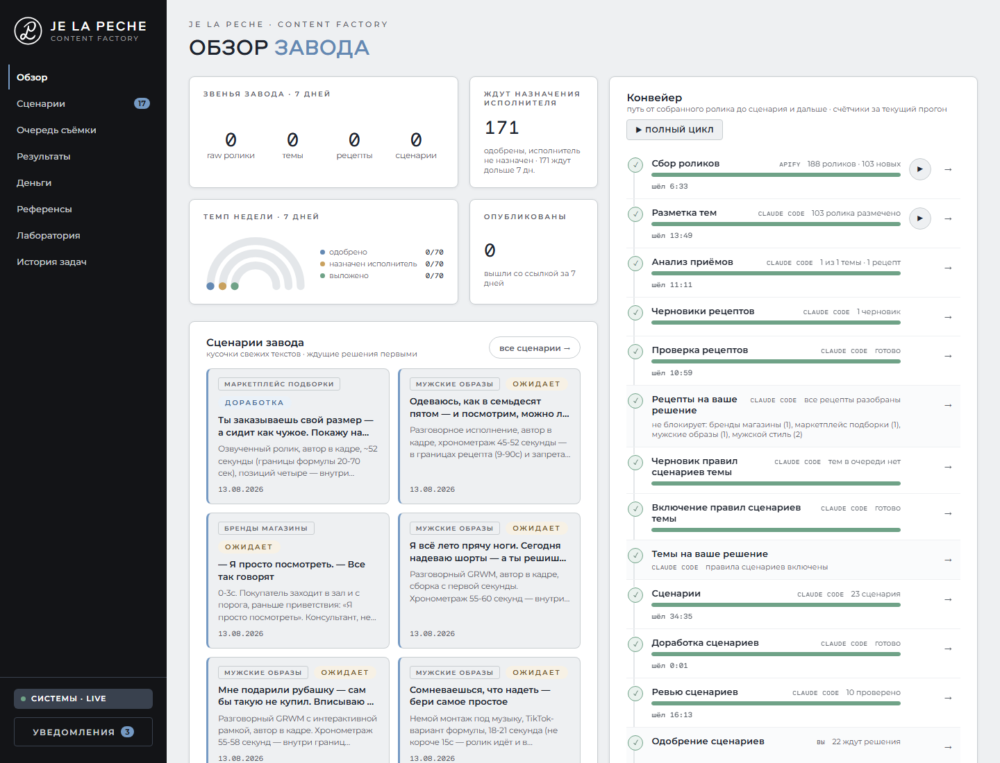
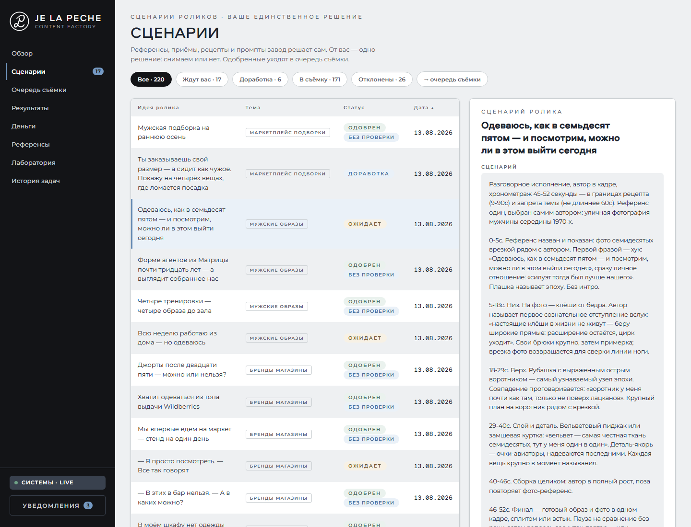

# Content Factory — контент-завод для бренда одежды

**От анализа коротких видео до сценария, готового к решению продюсера.**

Система для бренда мужской одежды **JE LA PECHE**: собирает референсы из TikTok и Instagram,
анализирует приёмы, составляет рецепты роликов и пишет по ним сценарии. Продюсер видит
результат в веб-интерфейсе, выбирает, что снимать, и передаёт сценарий в производство.

**Референсы → анализ → рецепты → сценарии → проверка → решение человека**

[Задача и решение](#задача-и-решение) · [Результаты](#результаты) · [Сценарии в интерфейсе](#сценарии-в-интерфейсе) · [Код и документация](#код-и-документация)

*Обзор завода: этапы обработки, последние сценарии и очередь решений. Скриншот от 28.09.2026.
Конвейер на паузе с 13.08.2026; на экране сохранённые данные, а не текущий выпуск.*

## Задача и решение

Бренду нужен собственный трафик из коротких видео для развития продаж на своём сайте.
Подготовка контента требовала ручной работы: искать референсы, сравнивать ролики,
выделять приёмы и превращать их в задания на съёмку.

Я спроектировал и собрал систему, которая связывает эти шаги в один процесс.
Её основной пользователь — **SMM-продюсер**: он работает со сценариями,
а сбор данных, анализ и первичную проверку выполняют агенты и код.

| Этап | Что делает система | Что получает пользователь |
| --- | --- | --- |
| Сбор | Загружает ролики и метрики через Apify, убирает дубли | Базу референсов по темам |
| Анализ | Сравнивает примеры и выделяет повторяющиеся приёмы | Рецепты роликов со ссылками на источники |
| Подготовка | Пишет сценарий по рецепту, проверяет и дорабатывает его | Текст, хук, план съёмки и референсы |
| Решение | Показывает сценарий и результаты проверок | Возможность одобрить или отклонить с комментарием |
| Производство | Собирает одобренные сценарии в очередь съёмки | Задания для исполнителей |

## Что я сделал

- Спроектировал путь от сбора референсов до сценариев и учёта результатов публикаций.
- Собрал агентный слой: анализ, создание рецептов, генерация, ревью и доработка сценариев.
- Разработал веб-интерфейс на FastAPI: обзор конвейера, сценарии, очередь съёмки и история задач.
- Настроил хранение данных в Google Sheets, расписания на VPS и сводки в Telegram.
- Добавил проверки качества, журнал решений, версионирование рецептов и сравнение версий промптов.

К защите проекта 29 июля 2026 года зафиксирован **21 день активной разработки — с 9 по 29 июля**.
После этого система дорабатывалась; июльский результат приведён ниже отдельно от более поздних скриншотов.

## Результаты

По [отчёту проекта на 29.07.2026](docs/FINAL-PROJECT-2026-07.md):

| Показатель | Результат |
| --- | --- |
| Собранные ролики-референсы | **4 588** из TikTok и Instagram |
| Источники сбора | **159** |
| Утверждённые рецепты роликов | **18 в 5 нишах** |
| Подготовленные сценарии | **87**, из них **79 одобрены** |
| Прогоны в журнале | **567** |
| Тесты на дату отчёта | **1 688**, все прошли |

**Что получилось:** сбор, анализ и подготовка сценариев работали на реальных данных.
У каждого сценария можно проследить происхождение до исходных роликов и версии рецепта.

**Статус:** реальные съёмки и публикации через конвейер не были запущены.
Обратная связь по метрикам проверена на синтетических данных: **12 из 12 проверок**,
включая случаи, когда данных недостаточно для вывода. Рост продаж и экономия времени
не измерялись. С **13.08.2026** автоматические запуски приостановлены.

## Сценарии в интерфейсе

Слева — очередь с темами и статусами, справа — выбранный сценарий с хронометражем
и указаниями для съёмки. После одобрения он попадает в очередь производства.

*Скриншот от 28.09.2026 с данными, накопленными до паузы. На нём 220 сценариев;
таблица выше отражает более ранний срез на 29 июля.*

## Как устроена система

**Принцип: агент оценивает смысл, код применяет правила, человек принимает бизнес-решение.**

- **Выводы опираются на источники.** Рецепт и сценарий связаны с референсами. Если данных мало,
  система возвращает `insufficient_data` и перечисляет, чего не хватает.
- **Проверки встроены в процесс.** Рецепты и правила тем проходят машинные проверки;
  выбор сценария для съёмки остаётся за человеком.
- **Изменения можно проверить и откатить.** Утверждённые рецепты сохраняются в неизменяемых
  версиях, а новая версия действующего промпта проходит A/B-сравнение.
- **История сохраняется.** Для сценария восстанавливается цепочка
  `референс → приём → рецепт → сценарий → версия промпта → публикация → метрики`.
  Последние два звена проверены на демонстрационных данных.

**Стек:** Python 3.12 · FastAPI · Jinja2 / HTMX · Google Sheets · Apify · Claude Code · systemd · Caddy · Telegram Bot API.

## Код и документация

Это публичная витрина рабочего проекта: исходный код, тесты, примеры и документация.
Рабочие ключи, конфигурация и полные базы компании в неё не входят.

| Что посмотреть | Где |
| --- | --- |
| Архитектура, состав витрины и локальный запуск | [README-SHOWCASE.md](README-SHOWCASE.md) |
| Дашборд и управление конвейером | [src/cf/dashboard/](src/cf/dashboard/) |
| Роли агентов | [prompts/agents/](prompts/agents/) |
| Примеры рецептов роликов | [formulas/](formulas/) |
| Проверки и тестовые сценарии | [tests/](tests/) |
| Отчёт с результатами на 29 июля | [FINAL-PROJECT-2026-07.md](docs/FINAL-PROJECT-2026-07.md) |
| Карта технической документации | [docs/README.md](docs/README.md) |
| Подробная база знаний, исторический срез | [README-TECHNICAL.md](README-TECHNICAL.md) |

Посмотреть интерфейс можно по скриншотам выше без установки.
Для проверки кода без внешних сервисов предусмотрены тесты с эмуляцией Google Sheets;
инструкции — в [описании витрины](README-SHOWCASE.md#как-запустить-локально-без-google-sheets).
